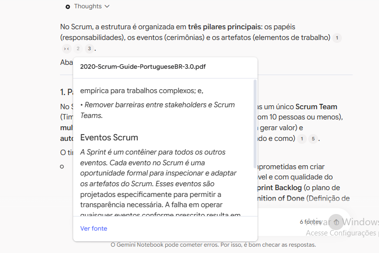
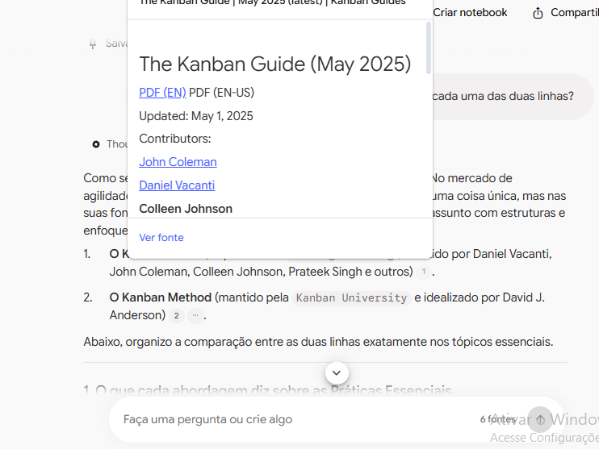
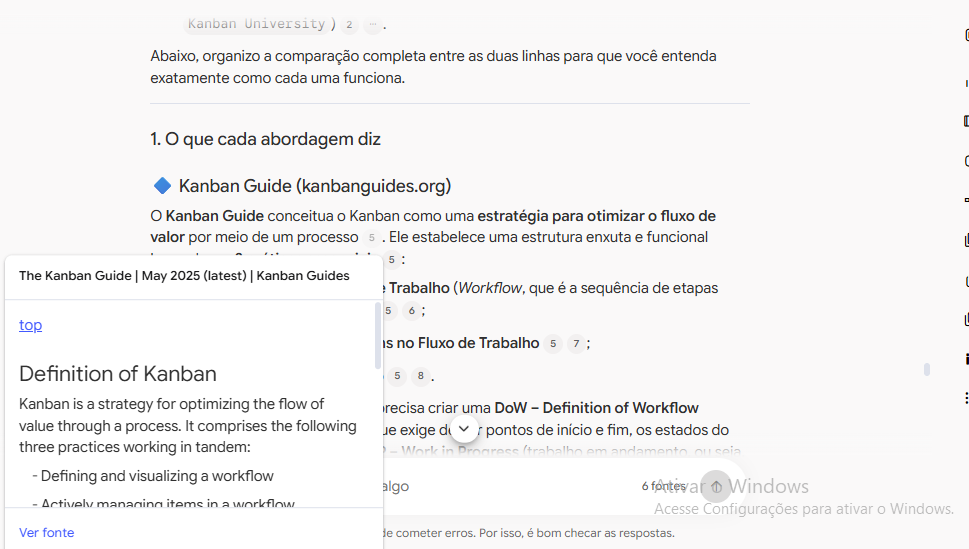
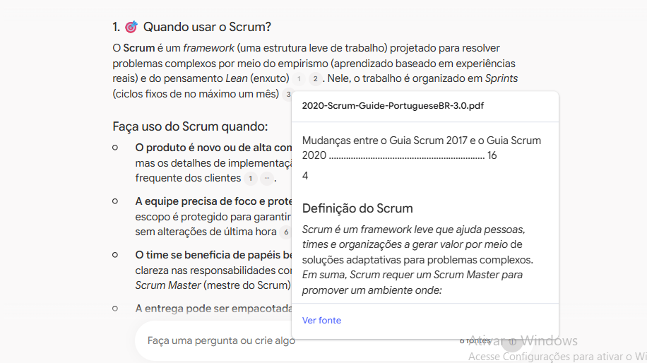
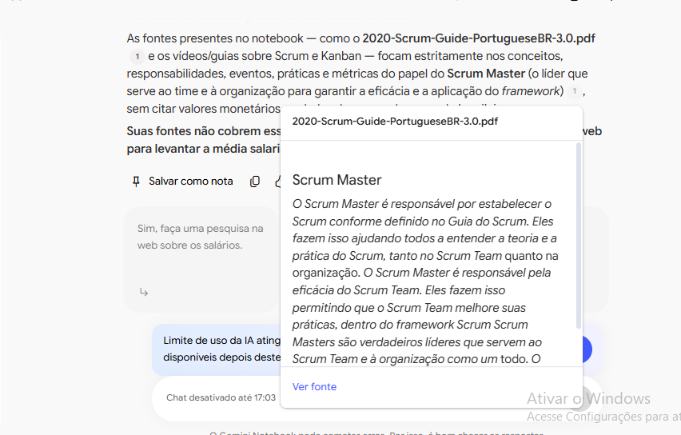

# 🧠 Segundo Cérebro: Scrum vs. Kanban

Notebook especialista em metodologias ágeis, criado no **Gemini Notebook** (antigo NotebookLM) como projeto do desafio da DIO. Ele responde só com base nas fontes que eu selecionei, mostra de onde tirou cada resposta e gera materiais de estudo.

> ✏️ **Como usar este README:** tudo marcado com ✏️ é para você completar. Apague estas observações antes de publicar.

🔗 **Notebook compartilhado:** [Segundo Cérebro: Scrum vs. Kanban](https://notebook.google.com/notebook/004e8bfb-8b97-4c46-a4f9-bdcba68e9a9d)

---

## 🎯 Tema e objetivo

**Tema:** Scrum e Kanban, comparados a partir dos guias oficiais.

**Objetivo:**
> "Quero entender de verdade o que são Scrum e Kanban, direto dos guias oficiais, e saber qual usar (ou como juntar os dois) em cada tipo de equipe."

### Critérios para uma fonte entrar

1. Foi escrita por quem criou ou mantém o método, ou por uma organização reconhecida na área.
2. Está atualizada (para o Scrum, reflete o guia de 2020).
3. Ensina, em vez de vender uma ferramenta ou um curso.
4. Traz algo que as outras fontes ainda não cobrem.

---

## 📚 Fontes

| # | Fonte | Formato | Idioma | Por que confio nela |
|---|-------|---------|--------|---------------------|
| 1 | [Guia do Scrum 2020](https://scrumguides.org/docs/scrumguide/v2020/2020-Scrum-Guide-PortugueseBR-3.0.pdf) — Ken Schwaber e Jeff Sutherland | PDF | PT-BR | Escrito pelos criadores do Scrum; é a definição oficial do framework. |
| 2 | [The Kanban Guide (maio/2025)](https://kanbanguides.org/the-kanban-guide/) — Kanban Guides | Site/PDF | EN | Referência oficial e mínima de Kanban, mantida pela comunidade de praticantes. É a minha fonte em outra língua. |
| 3 | [The Official Guide to The Kanban Method](https://kanban.university/new-to-kanban-get-the-official-guide-to-the-kanban-method/) — Kanban University | PDF | EN | Publicado pela instituição fundada por David J. Anderson, a "casa" do Kanban Method. Representa a segunda escola de Kanban. |
| 4 | [The Kanban Method — David J. Anderson (Kanban Experts Series)](https://www.youtube.com/watch?v=FmZ-tAV-Gb0) — Kanban University | YouTube | EN | O próprio criador do Kanban Method explica o método no canal oficial da Kanban University. |
| 5 | [Scrum vs. Kanban 2026 — Diferença entre Scrum e Kanban](https://www.youtube.com/watch?v=3dWWG2TJ7Fs) — canal Jiraverso | YouTube | PT-BR | Compara as duas abordagens na prática, em português. O canal leva o nome de uma ferramenta (Jira), então conferi se o vídeo ensinava em vez de vender: ele explica os conceitos sem depender da ferramenta. |
| 6 | [What is Scrum? Explained Simply for Beginners](https://www.youtube.com/watch?v=NB-yTr0XMoc) — canal Ram N Java | YouTube | EN | Introdução bem simples ao Scrum, para iniciantes. É a fonte com menos autoridade, porque o canal é de programação e não de agilidade. Entrou só como apoio didático, e o que vale como definição é o Guia do Scrum. |

**Fontes que o Deep Research sugeriu e eu recusei:**
- ✏️ *Exemplo: "Blog X — recusei porque é página de venda de ferramenta."*

---

## 🧭 Diretriz de comportamento

Texto que colei na configuração do notebook (cópia também em [`docs/diretriz.md`](docs/diretriz.md)):

```text
Comporte-se como um agile coach experiente, especialista em Scrum e Kanban.

Regras:
1. Responda somente com base nas fontes deste notebook. Se a resposta não
   estiver nelas, diga claramente que as fontes não cobrem o assunto.
2. Sempre indique de qual fonte veio cada informação.
3. Diferencie as duas linhas de Kanban: o Kanban Guide (kanbanguides.org)
   e o Kanban Method (Kanban University). Não trate as duas como se
   fossem a mesma coisa.
4. Quando eu pedir comparações, organize a resposta em: o que cada
   abordagem diz, onde concordam, onde divergem e quando cada uma
   faz mais sentido.
5. Explique os termos em inglês na primeira vez que aparecerem
   (ex.: Sprint, WIP, Lead Time).
6. Responda em português do Brasil, de forma didática, como para alguém
   que está começando em metodologias ágeis.
```

---

## 💬 Perguntas e respostas

> As respostas abaixo são resumos das respostas do notebook. Os prints mostram as citações clicáveis que levam ao trecho de cada fonte. Mais perguntas de teste estão em [`docs/perguntas.md`](docs/perguntas.md).

### 0. Teste da diretriz: "Quais são as fontes deste notebook e sobre o que cada uma fala?"
- **Resposta (resumo):** o notebook listou as 6 fontes, resumiu cada uma em português e separou por conta própria as duas linhas de Kanban, marcando qual fonte pertence ao Kanban Guide e quais pertencem ao Kanban Method. Isso mostra que a regra 3 da diretriz funcionou.
- **Fontes citadas:** todas as 6.

### 1. Quais são os papéis, eventos e artefatos do Scrum?
- **Resposta (resumo):** o Scrum tem um único Scrum Team, pequeno (normalmente 10 pessoas ou menos), multifuncional e autogerenciável, com três responsabilidades: **Developers**, **Product Owner** (uma pessoa, não um comitê) e **Scrum Master**. Os eventos acontecem dentro da **Sprint** (até um mês): Sprint Planning (até 8h), Daily Scrum (15 min), Sprint Review (até 4h) e Sprint Retrospective (até 3h). Os três artefatos têm um compromisso cada: Product Backlog → **Product Goal**, Sprint Backlog → **Sprint Goal** e Increment → **Definition of Done**.
- **Fontes citadas:** Guia do Scrum 2020 (PT-BR). O print mostra a citação aberta no trecho "Eventos Scrum" do PDF.
- **Evidência:** 

### 2. Quais são as práticas essenciais do Kanban segundo cada uma das duas linhas?
- **Resposta (resumo):**
  - **Kanban Guide:** 3 práticas: definir e visualizar o fluxo (com uma *Definition of Workflow*, que inclui o SLE), gerenciar ativamente os itens e melhorar o fluxo. Exige 4 métricas: WIP, Throughput, Work Item Age e Cycle Time.
  - **Kanban Method:** 6 práticas gerais: visualizar, limitar o WIP, gerenciar o fluxo, tornar as políticas explícitas, implementar ciclos de feedback (*cadências*) e melhorar colaborativamente e evoluir experimentalmente. Para desenhar o sistema, usa o STATIK, em 6 passos.
  - As duas linhas **concordam** em usar um sistema puxado (*pull*), em limitar o WIP, nas políticas explícitas e na melhoria evolutiva, e **divergem** no nível de prescrição, nas métricas e nas reuniões.
- **Fontes citadas:** The Kanban Guide (maio/2025), The Official Kanban Guide (PDF da Kanban University) e o vídeo "The Kanban Method", de David J. Anderson. O print mostra a citação do Kanban Guide aberta.
- **Evidência:** 

### 3. Qual a diferença entre o Kanban Guide e o Kanban Method?
- **Resposta (resumo):** o **Kanban Guide** é **minimalista**: 3 práticas, 4 métricas obrigatórias e melhorias feitas a qualquer momento (*just-in-time*), sem reuniões obrigatórias. O **Kanban Method** é **abrangente**: trata o Kanban como um método de gestão aplicado por cima do processo atual ("comece com o que você faz agora"), com princípios de gestão de mudança, cadências formais, classes de serviço, STATIK e um modelo de maturidade (KMM), e dá mais destaque ao Lead Time. O Guide serve melhor a um time que quer otimizar o fluxo com dados e de forma leve. O Method serve melhor a uma organização que busca uma mudança cultural gradual, sem mexer em cargos de forma brusca.
- **Fontes citadas:** The Kanban Guide, The Official Kanban Guide (PDF da Kanban University) e o vídeo de David J. Anderson. O print mostra a citação aberta em "Definition of Kanban": *"Kanban is a strategy for optimizing the flow of value through a process"*.
- **Evidência:** 

### 4. Quando usar Scrum, quando usar Kanban e quando combinar os dois?
- **Resposta (resumo):**
  - **Scrum:** produtos novos ou complexos, times que precisam de foco e de proteção do escopo durante a Sprint, e papéis bem definidos.
  - **Kanban Method:** suporte, operação e manutenção, onde as demandas chegam o tempo todo, e organizações que querem evoluir sem uma reestruturação radical.
  - **Kanban Guide:** times que querem otimizar métricas de fluxo sem mudar papéis nem eventos.
  - **Combinação:** Scrum e Kanban não são rivais. O Scrum funciona como um "contêiner" para outras práticas, e o Kanban Method pode ser aplicado por cima dele. Um time Scrum pode usar limites de WIP, entrega contínua e métricas de fluxo, como Cycle Time e Throughput, para enriquecer a Retrospectiva.
- **Fontes citadas:** Guia do Scrum 2020 (o print mostra a citação aberta em "Definição do Scrum"), The Kanban Guide, The Official Kanban Guide (Kanban University) e o vídeo de David J. Anderson.
- **Evidência:** 

### 5. Teste de honestidade: "Qual o salário médio de um Scrum Master no Brasil?"
- **Resposta (resumo):** o notebook respondeu que **nenhuma das fontes cobre salário ou mercado de trabalho**, porque elas tratam só de conceitos, papéis, eventos e práticas. Em vez de inventar um número, ele ofereceu fazer uma pesquisa na web, que não usei no README, porque o objetivo era testar se ele se limita às fontes. O print mostra a citação do Guia do Scrum, usada para dizer o que as fontes cobrem sobre o Scrum Master.
- **Por que importa:** mostra que a regra 1 da diretriz funciona e que o notebook não "alucina" quando a resposta não está nas fontes.
- **Evidência:** 

---

## 🎓 Materiais gerados no Estúdio

| Material | Arquivo |
|----------|---------|
| Mapa mental | [`materiais/mapa-mental.jpg`](materiais/mapa-mental.jpg) |
| Slides "Sistemas Operacionais Ágeis" (15 slides) | [`materiais/slides.pdf`](materiais/slides.pdf) |
| Guia de estudos (quiz + glossário) | ✏️ [`materiais/guia-de-estudos.pdf`](materiais/guia-de-estudos.pdf) |
| Resumo em áudio "A verdadeira diferença entre Scrum e Kanban" (~26 min) | [`materiais/resumo-audio.m4a`](materiais/resumo-audio.m4a) |

> ✏️ Remova da tabela o que você não gerar. Todo arquivo citado aqui precisa existir no repositório.

---

## 💡 O que aprendi

- **Existem dois "Kanbans".** Eu achava que Kanban era só um quadro com colunas. Descobri que há duas linhas oficiais: o Kanban Guide, mais enxuto e focado em métricas, e o Kanban Method, mais amplo e focado em mudar a organização aos poucos.
- **Scrum e Kanban não são rivais.** As fontes mostram que dá para usar os dois juntos, por exemplo colocando limite de WIP dentro de uma Sprint.
- **A diretriz faz diferença.** Quando pedi para separar as duas linhas de Kanban e explicar os termos em inglês, as respostas ficaram muito mais claras.
- **Fontes em inglês não foram problema.** Metade das fontes está em inglês, e o notebook respondeu tudo em português, traduzindo e explicando os termos.
- **O notebook não inventa no chat.** Na pergunta sobre salário, ele admitiu que as fontes não cobrem o assunto, em vez de chutar um número.
- **Mas os materiais do Estúdio precisam ser conferidos.** Nos slides, aparecem números como "Risk reduction: +20%" e "Flow efficiency: +25%", que não estão em nenhuma das fontes: são decoração inventada pelo gerador. E o mapa mental colocou dentro de "O Método Kanban" coisas que vêm do Kanban Guide (como a definição "estratégia para otimizar o fluxo de valor" e as métricas Work Item Age e Throughput), ou seja, juntou as duas linhas que a minha diretriz pedia para separar. A diretriz vale para o chat, não para o Estúdio. Conclusão: a IA organiza, mas quem confere sou eu.

---

## ✅ Checklist de entrega

- [ ] Cada resposta citada no README mostra de qual fonte veio
- [ ] O notebook abre pelo link (testado numa aba anônima)
- [ ] Nenhuma fonte tem dado pessoal ou material que não posso compartilhar
- [ ] Todo arquivo citado no README existe e tem conteúdo
- [ ] O link enviado à DIO é o do **repositório**, não o do notebook
- [ ] O repositório está na minha conta e é **público**
- [ ] Nome do repositório legível, em minúsculas e sem acento: `segundo-cerebro-scrum-kanban`

---

Projeto desenvolvido para o desafio **"Segundo Cérebro com IA"** da [DIO](https://www.dio.me/).
